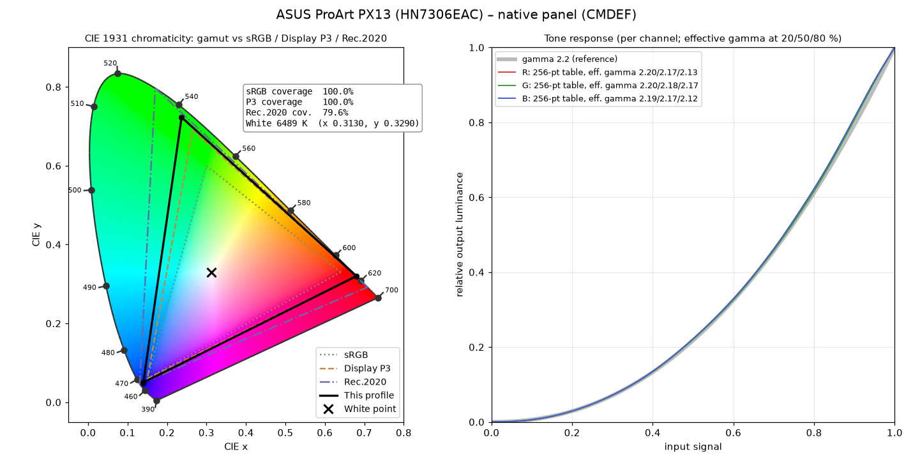
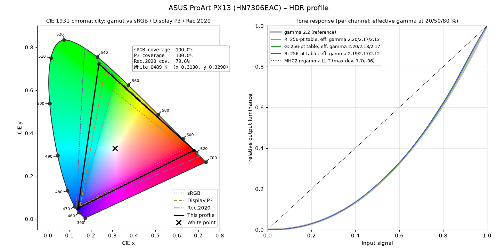
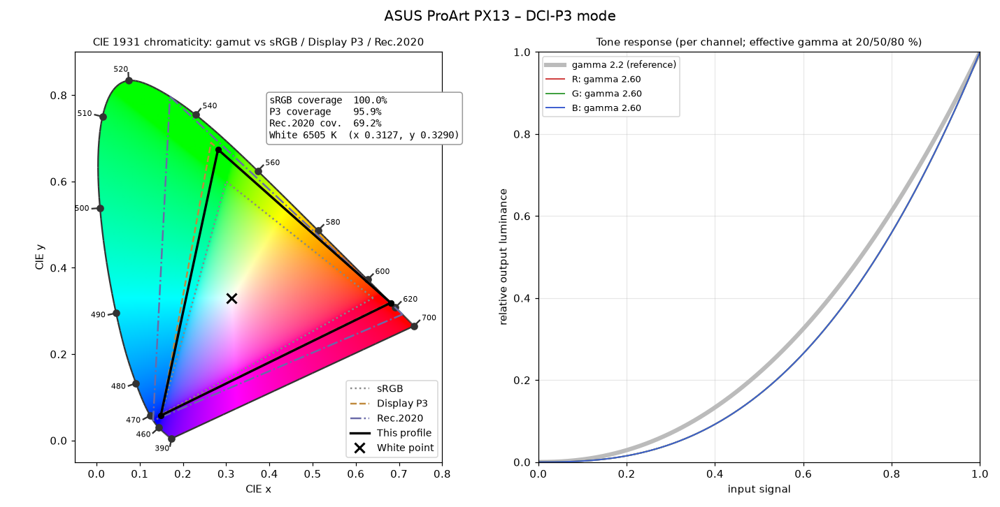
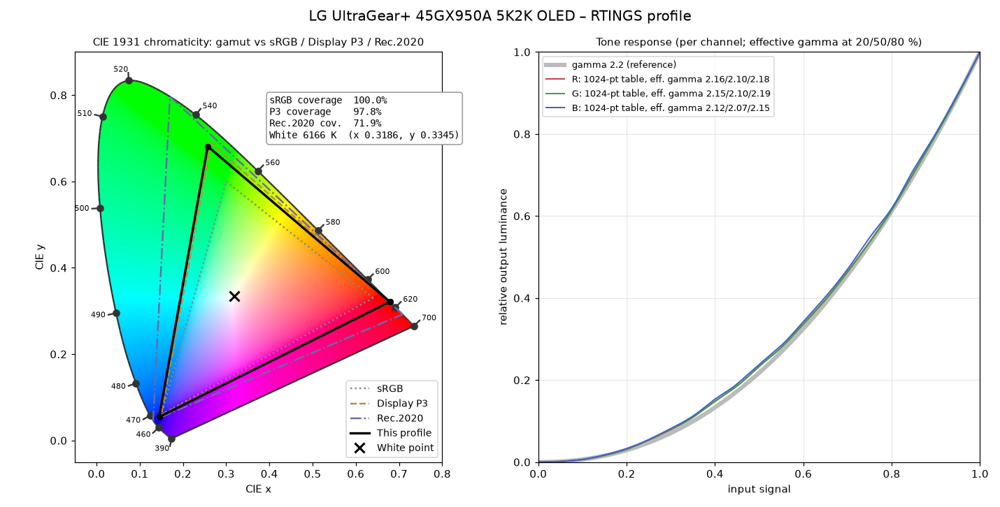

# Color profiles: ASUS ProArt PX13 and LG UltraGear 45GX950A-B on Linux

ICC profiles for my two displays, what each one contains, and how they're applied on Linux. They go through [niri's `erikg-hdr` branch](https://github.com/gonzalezerik/niri/tree/erikg-hdr), which programs a profile into the GPU's display pipeline: DEGAMMA → CTM (3×3 matrix) → GAMMA, KDE Plasma-style. You pick a profile in the Control Center's Display page.

| Display | Panel | Profiles |
|---|---|---|
| **ASUS ProArt PX13** (HN7306EAC), 13.3" 2880×1800 OLED, 60 Hz, HDR (10-bit, BT.2020/PQ, ~617 nits peak) | ATNA33AA08 | native (CMDEF), HDR, sRGB, Display P3, DCI-P3 (factory, from ASUS) |
| **LG UltraGear 45GX950A-B** ("LG ULTRAGEAR+" in its EDID), 45" 5120×2160 (5K2K) OLED, 165 Hz, HDR | WOLED | RTINGS calibration (CalMAN) |

**In use:** the px13 runs **CMDEF** with **HDR** as its HDR profile at SDR colour intensity 50; the desktop runs the **RTINGS** profile at intensity 0 (pure sRGB rendering).

Every chart below comes from the profile file itself (`tools/`, see the end of this page). On the left, the CIE 1931 chromaticity diagram: the profile's primaries and white point against sRGB, Display P3 and Rec.2020. On the right, the per-channel tone response curves against a plain gamma 2.2.

**Download:** all six profiles are in [`icc/`](icc/):

| File | Display | Profile |
|---|---|---|
| [`HN7306EAC_1002_CMDEF.icm`](icc/HN7306EAC_1002_CMDEF.icm) | ASUS ProArt PX13 | native panel, factory-calibrated (SDR) |
| [`HN7306EAC_1002_HDR.icm`](icc/HN7306EAC_1002_HDR.icm) | ASUS ProArt PX13 | native panel, HDR |
| [`HN7306EAC_1002_sRGB.icm`](icc/HN7306EAC_1002_sRGB.icm) | ASUS ProArt PX13 | sRGB colour mode (MHC2 clamp) |
| [`HN7306EAC_1002_DisplayP3.icm`](icc/HN7306EAC_1002_DisplayP3.icm) | ASUS ProArt PX13 | Display P3 colour mode (MHC2 clamp) |
| [`HN7306EAC_1002_DCIP3.icm`](icc/HN7306EAC_1002_DCIP3.icm) | ASUS ProArt PX13 | DCI-P3 colour mode (MHC2 clamp) |
| [`LG_45GX950A-B_RTINGS.icm`](icc/LG_45GX950A-B_RTINGS.icm) | LG UltraGear 45GX950A-B | RTINGS calibration |

The ASUS files are ASUS's, unchanged except that a per-panel ID was removed from their file names and description text (`tools/iccrename.py`; every other tag is byte-identical). The LG file is RTINGS' profile as published. On Linux, put them in `~/.local/share/icc`; on Windows, install them through Colour Management.

## How the numbers were read

- **Primaries and white point** come from the profile's `rXYZ`/`gXYZ`/`bXYZ` colorants. ICC stores colorants adapted to the D50 profile connection space, so they're un-adapted first: through the `chad` tag where there is one, otherwise with Bradford from the media white point (`wtpt`), as ICC v2 specifies. A check that this is right: the ASUS sRGB and Display P3 profiles come out exactly on the sRGB and P3 primaries, with a D65 white.
- **Coverage** is the share of a reference gamut's triangle inside the profile's triangle, in CIE 1931 xy (CIE 1976 u′v′ in the tables). **Relative area** is the size of the profile's triangle compared to the reference; above 100 % means bigger, not necessarily covering more.
- **Effective gamma** is log(output)/log(input) at 20 %, 50 % and 80 % input, from the tone curves.

---

## ASUS ProArt PX13 (HN7306EAC)

ASUS's factory profiles for the PX13 are Windows files (a `px13ICM` folder, `sdr/` + an HDR profile). Their names carry the model, a panel ID and the mode, e.g. `HN7306EAC_1002_<panel-id>_CMDEF.icm`; the copies here drop the panel ID.

The five files are two different kinds of profile:

- **CMDEF** and **HDR** describe the **panel itself**: its native primaries and its measured tone curves ("Calibrate by ASUS", 256-point tables per channel). This is what a colour-managed pipeline needs.
- **sRGB**, **Display P3** and **DCI-P3** are Windows **"clamp" profiles**: their colorants are the *target* gamut (exact sRGB / P3 primaries) and the real work is a Microsoft **MHC2** 3×3 matrix that squeezes the native panel into that gamut. They're what ASUS's "colour modes" switch between on Windows. niri doesn't apply MHC2 matrices (neither does KDE), so on Linux these just describe a smaller display than the real one.

### Native panel (CMDEF) - the one to use



| | Red | Green | Blue | White |
|---|---|---|---|---|
| CIE x, y | 0.680, 0.320 | 0.237, 0.723 | 0.140, 0.050 | 0.3130, 0.3290 (6489 K) |

| Coverage | sRGB | Display P3 | Rec.2020 |
|---|---|---|---|
| xy | 100 % | 100 % | 79.6 % |
| u′v′ | 100 % | 100 % | 79.9 % |
| relative area | 150.5 % | 110.9 % | 79.6 % |

- **Wider than Display P3**: green sits well out at 0.237, 0.723 (P3 green: 0.265, 0.690). Red and white match P3/D65 almost exactly.
- **Tone response**: 256-point tables per channel, effective gamma ≈ 2.20 / 2.17 / 2.13 (20/50/80 %); the channels track each other within ±0.04, so greys stay neutral.
- **Luminance**: 374 cd/m² SDR white in the profile (`lumi`); the HDR peak in the MHC2 block is ~617 nits.
- The primaries are round to five decimals (0.680/0.320, 0.237/0.723, 0.140/0.050), so they're the panel's nominal values, not a per-unit measurement. The calibrated part is the tone curves (red, green and blue differ, so they were measured per channel).
- In niri: SDR content is converted from sRGB to the panel through the CTM, and **SDR colour intensity** picks a point between accurate sRGB (0) and stretched to the full native gamut (100). The px13 runs 50.

### HDR



Same primaries and tone curves as CMDEF, plus an **MHC2 block with a 1024-point regamma LUT per channel and an identity matrix**. The LUT's largest deviation from a straight line is 7.7 × 10⁻⁶, so it's effectively a no-op: nothing gets corrected in HDR beyond what the panel does itself. niri swaps to this profile while the output is in HDR mode.

### sRGB (clamp)


Exactly the sRGB primaries (0.64/0.33, 0.30/0.60, 0.15/0.06), D65 white, gamma 2.2, 80 cd/m². Its MHC2 matrix (diagonal 0.594 / 1.094 / 0.904) is how Windows pulls the native panel down to sRGB. Covers 73.7 % of P3 and 52.9 % of Rec.2020, by definition.

### Display P3 (clamp)


Exactly the Display P3 primaries, D65 white, gamma 2.2, 400 cd/m². The MHC2 matrix is close to identity (diagonal 0.826 / 1.042 / 0.997), because the native panel is only a little wider than P3.

### DCI-P3 (clamp)



Gamma 2.6 (the cinema transfer function), but a D65 white instead of DCI's ~6300 K greenish white: in practice "P3-D65 at gamma 2.6". Green lands at 0.281, 0.674, a little inside P3 (95.9 % P3 coverage).

| Profile | Primaries | White | Tone curve | sRGB | P3 | Rec.2020 |
|---|---|---|---|---|---|---|
| CMDEF (native) | panel native | 6489 K | 256-pt tables, γ≈2.17 | 100 % | 100 % | 79.6 % |
| HDR | panel native | 6489 K | tables + MHC2 1024-pt LUT (identity) | 100 % | 100 % | 79.6 % |
| sRGB | sRGB | D65 | γ 2.2 | 100 % | 73.7 % | 52.9 % |
| Display P3 | P3 | D65 | γ 2.2 | 100 % | 100 % | 71.7 % |
| DCI-P3 | ≈P3 | D65 | γ 2.6 | 100 % | 95.9 % | 69.2 % |

---

## LG UltraGear 45GX950A-B (45" 5K2K OLED)

A calibration profile from [RTINGS' review of the 45GX950A-B](https://www.rtings.com/monitor/reviews/lg/45gx950a-b) (made with CalMAN, SpectraCal; device name "LG ULTRAGEAR+", April 2025): [`icc/LG_45GX950A-B_RTINGS.icm`](icc/LG_45GX950A-B_RTINGS.icm), originally from the review page.



| | Red | Green | Blue | White |
|---|---|---|---|---|
| CIE x, y | 0.679, 0.321 | 0.257, 0.682 | 0.145, 0.055 | 0.3186, 0.3345 (6166 K) |

| Coverage | sRGB | Display P3 | Rec.2020 |
|---|---|---|---|
| xy | 100 % | 97.8 % | 71.9 % |
| u′v′ | 100 % | 99.2 % | 74.6 % |
| relative area | 135.9 % | 100.2 % | 71.9 % |

- **Gamut**: essentially Display P3 (100.2 % of its area, 97.8 % coverage in xy, 99.2 % in u′v′): green sits slightly short of P3's corner, red slightly past it.
- **White point**: measured at 6166 K (x 0.3186, y 0.3345), warmer and a touch greener than D65, which is exactly what the profile corrects.
- **Tone response**: 1024-point tables per channel, effective gamma ≈ 2.16 / 2.10 / 2.18, slightly brighter than 2.2 in the mid-tones; blue runs a little low (2.12 / 2.07 / 2.15).
- The `chad` tag is CalMAN's chromatic adaptation from the measured white to D50; it's undone before plotting.
- The desktop's NVIDIA driver exposes DEGAMMA_LUT, CTM and GAMMA_LUT on its CRTC, so niri applies this in hardware, like on the px13's AMD GPU.

---

## Regenerating the charts

```sh
python3 tools/iccdump.py icc/HN7306EAC_1002_CMDEF.icm > profile.json      # stdlib only
python3 tools/analyze.py profile.json chart.png "Title" > summary.json
```

`analyze.py` needs `colour-science`, `matplotlib`, `numpy` and `shapely` (`pip install colour-science matplotlib shapely`).
